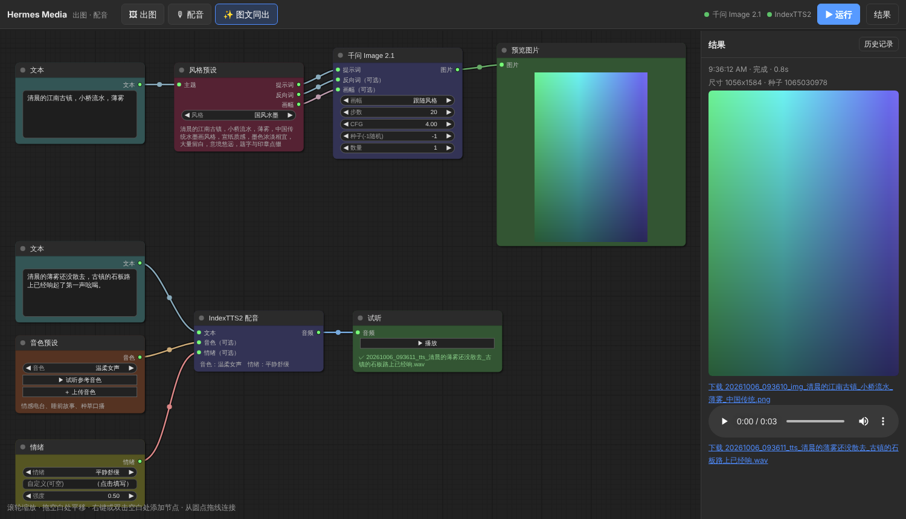

# hermes-media：本地出图 / 配音工作台

不用启动 ComfyUI，也能用 **ComfyUI 那样的节点界面**，调用你本地的：

- **千问 Qwen-Image 2.1** 出图（直接用 diffusers 跑模型）
- **IndexTTS2 / 2.5** 配音（克隆参考音色，带情绪控制）

出图和配音的工作流都**预先连好了**，风格、音色、情绪都**做成了下拉框**，选一下、改改文字、点「运行」就出结果。
同一套预设也接进了 **Hermes Agent**，在聊天里说一句 `/img 江南古镇 国风` 或 `/voice 欢迎收看本期节目` 就能出图 / 配音。



> 截图里的图片是测试用的假模型生成的色块，接上真模型就是真实出图。

## 一、能做什么

**三个预设工作流**（顶部按钮一键切换，改动会自动保存）：

| 预设 | 连好的节点 |
|---|---|
| 🖼 出图 | 文本 → 风格预设 → 千问 Image 2.1 → 预览图片 |
| 🎙 配音 | 文本 + 音色预设 + 情绪 → IndexTTS2 配音 → 试听 |
| ✨ 图文同出 | 上面两条一起跑，一次出一张配图 + 一段配音 |

**内置预设**（都在 `presets/` 下的 YAML 里，可随意增删改，刷新页面就生效）：

- **19 种出图风格**：写实摄影、电影大片、人像写真、电商产品图、小红书封面、海报设计、日系动漫、国风水墨、清新水彩、儿童绘本、扁平插画、3D 卡通、黏土定格、赛博朋克、奇幻概念、古典油画、像素游戏、头像、不加风格。
  每种风格自带提示词模板、反向词和推荐画幅（千问官方推荐分辨率）。
- **12 种情绪**：跟随音色、平静舒缓、开心、激动热情、温柔、悲伤、生气、惊讶、害怕、低沉神秘、撒娇可爱、严肃播报。也可以自己写一句情绪描述。
- **音色**：
  - 预留了 6 个音色位：旁白·沉稳男声、温柔女声、新闻播报、活力带货、童声、老者。放一段对应的参考音频就能用。
  - 也可以在界面上点「＋ 上传音色」添加自己的声音。
  - 配好 IndexTTS 目录后，它自带的示例音色也会自动出现，开箱就能试。

**合成短视频（🎬 命令行）**：
- 写一个分镜脚本（YAML，见 [`examples/江南古镇.yaml`](examples/江南古镇.yaml)），每个镜头一句旁白 + 一句画面描述。
- `hermes-media video 脚本.yaml` 会逐句配音、逐镜头出图，再用 ffmpeg 合成带**运镜、转场、字幕**的 MP4（默认竖屏 1080×1920），同时输出一份 `.srt` 字幕。
- 镜头时长由配音长度自动决定，字幕按句对齐，不用手动打轴；响度统一到 -14 LUFS。
- 图和配音都有缓存：改了一句旁白再跑，只重新配那一句，几秒就能出新片。
- 不用单独装 ffmpeg：系统里没有时会用自动安装的 `imageio-ffmpeg`。也可以在 `config.yaml` 的 `video.ffmpeg` 里指定。

**模型管理（📦 模型）**：
- 一键下载出图模型，下载完就出现在「千问 Image 2.1」节点的「模型」下拉框里，选哪个就用哪个。切换时会自动重新加载。
- 支持 HuggingFace、HF 国内镜像、ModelScope 魔搭三种下载源，断了重试会接着下。
- 目录里已经放好的模型：

| 模型 | 说明 |
|---|---|
| 千问 Image 2.1 官方版 | 完整权重，约 30GB，其它变体都依赖它的文本编码器和 VAE |
| Uncensored · GGUF Q8（社区） | 量化版扩散模型约 7.6GB，画质几乎无损 |
| Uncensored · GGUF Q4_K_M（社区） | 约 4.6GB，适合小显存 |
| Uncensored · 完整版（社区） | 社区上传的完整目录，未验证格式 |

> 关于「无审查版」：多方测试表明，**千问 Image 2.1 官方权重在本地运行时本身就没有内容过滤**（过滤只存在于阿里云的在线服务）。社区标 "Uncensored" 的版本主要是同一份权重的量化版，好处是**省显存**，而不是放开了什么。另外模型使用的是 Qwen Research License（仅限研究和评估用途，商用需要另外和阿里签协议）。
>
> 社区仓库可能改名或删除，下载失败时界面会显示原因。也可以在 `presets/models.yaml` 里加别的仓库，或在 `config.yaml` 的 `image.models` 里手动加本地模型（支持替换扩散模型、文本编码器和 LoRA）。
>
> 使用 GGUF 版本需要较新的 diffusers，并在千问的 Python 环境里安装 `gguf`：`pip install -U diffusers gguf`。

**和 ComfyUI 一样的操作**：
- 滚轮缩放，拖动空白处平移；从圆点拖线连接；右键或双击空白处添加节点。
- `Ctrl+Enter` 运行。正在跑的节点有绿框，出错的节点有红框。
- 任务排队执行，不会抢显卡。

## 二、为什么这么做（GitHub 调研）

| 项目 | ⭐ | 结论 |
|---|---|---|
| [ATH-MaaS/Pixelle-MCP](https://github.com/ATH-MaaS/Pixelle-MCP) | ~1.1k | ComfyUI 工作流 → MCP 工具，思路最好，但必须跑 ComfyUI |
| [artokun/comfyui-mcp](https://github.com/artokun/comfyui-mcp) | ~790 | 178 个工具，太重，且依赖 ComfyUI |
| [jau123/MeiGen-AI-Design-MCP](https://github.com/jau123/MeiGen-AI-Design-MCP) | ~1.8k | 以云端模型为主 |
| 本地 Qwen-Image 2.1 / IndexTTS2 API 类项目 | <30 | 只管出图或只管配音 |

没有现成的「不跑 ComfyUI、但有 ComfyUI 界面、预设好千问 + IndexTTS2」的项目，所以：

- **界面直接用 ComfyUI 同款画布库** [litegraph.js](https://github.com/jagenjo/litegraph.js)（MIT，已内置，离线可用）。
- **节点由后端声明、前端自动生成**，这是照搬 ComfyUI 的做法。
- **两个模型各自常驻一个进程**，模型只加载一次。
- **ComfyUI 工作流的参数标注语法**沿用 Pixelle-MCP 的写法；这只在可选的 ComfyUI 后端里用到。

## 三、安装（3 步）

### 1. 下载并生成配置

```bash
git clone https://github.com/cuijinan0405-art/cuijinan.git hermes-media
cd hermes-media
```

- **Windows**：双击 `start.bat`。第一次会自动安装，并用记事本打开 `config.yaml`。
- **Linux / macOS**：运行 `./start.sh`。

### 2. 改 `config.yaml` 里带 ★ 的 3 处

```yaml
image:
  local:
    python: D:/qwen-image/python/python.exe   # ★1 装了 torch + diffusers 的 Python
    model: D:/models/Qwen-Image-2.1           # ★2 已有的千问 Image 2.1 模型目录（没有就用界面「📦 模型」下载）
tts:
  local:
    index_tts_dir: D:/index-tts               # ★3 你的 index-tts 目录
    python: uv run python                     #    整合包就写它自带的 python.exe 路径
```

- 两个模型都用**各自原来的 Python 环境**运行，本项目不往里装任何东西。
- 显存不够时，把 `image.local.offload` 改成 `true`，或者在「📦 模型」里下载 GGUF 量化版。

### 3. 再次双击 `start.bat`（或 `./start.sh`）

- 浏览器会自动打开 `http://127.0.0.1:8765`，两个模型在后台加载。
- 右上角的绿点表示模型已就绪。
- 关掉窗口时，模型进程会一起退出，不会残留占用显存。

### 放音色

把 3~10 秒、干净无背景音的人声放进 `voices/` 目录，文件名对应预设，例如 `voices/温柔女声.wav`；也可以直接在界面「音色预设」节点上点「＋ 上传音色」。

自检命令：`.venv/bin/hermes-media doctor`。它会列出配置、启动命令、模型状态，以及哪些预设音色还缺音频。

## 四、接入 Hermes Agent（可选）

在 `~/.hermes/config.yaml` 里加上（服务名必须是 `media`）：

```yaml
mcp_servers:
  media:
    command: "D:/hermes-media/.venv/Scripts/hermes-media.exe"   # Linux/mac: /path/to/hermes-media/.venv/bin/hermes-media
    args: ["-c", "D:/hermes-media/config.yaml", "serve"]
    timeout: 1800
```

再把 skill 复制进去，就有了 `/img` 和 `/voice` 两个斜杠命令：

```bash
cp -r skills/img skills/voice ~/.hermes/skills/creative/
```

- Hermes 和网页界面**共用同一组预设**。
- 如果网页界面开着，Hermes 会**直接复用已经加载好的模型**；界面没开时，Hermes 用到才自动启动模型。

```
/img 一只戴墨镜的橘猫在海边冲浪
/img 小红书封面，标题"周末去哪玩"
/voice 用旁白的声音，低沉地说：故事，要从三十年前说起
帮我写一段 30 字的咖啡店开业口播，用活力带货的声音配音
```

Hermes 可用的工具：`generate_image`（含 `style` 风格、`model` 模型参数）、`text_to_speech`、`list_styles`、`list_voices`。

## 五、命令行

```bash
hermes-media ui                                   # 打开节点界面
hermes-media image "江南古镇" -s 国风水墨 -r 9:16    # 直接出图
hermes-media tts "你好呀" -v 温柔女声 -e 开心         # 直接配音
hermes-media presets                              # 列出风格 / 音色 / 情绪
hermes-media models                               # 列出出图模型（已下载 / 可下载）
hermes-media download qwen-image-2.1 --source hf-mirror   # 命令行下载模型
hermes-media image "江南古镇" -m "GGUF Q8"           # 指定模型出图
hermes-media video examples/江南古镇.yaml          # 按分镜脚本合成短视频
hermes-media doctor                               # 自检
hermes-media serve                                # MCP 服务（给 Hermes 用）
```

## 六、目录结构

```
hermes_media/
  webapp.py      网页服务（标准库实现，无额外依赖）
  nodes.py       节点定义 + 图执行器
  presets.py     风格 / 音色 / 情绪预设
  storyboard.py  分镜脚本 → 出图 + 配音（带缓存）→ 合成视频
  video.py       时间轴、字幕、ffmpeg 命令
  models.py      出图模型列表（目录 + 已下载 + 自定义）
  downloads.py   模型下载（HuggingFace / 镜像 / 魔搭）
  workers.py     模型常驻进程管理（自动启动、复用、随主程序退出）
  backends.py    出图 / 配音后端：local（默认）、openai 兼容、comfyui（可选）
  server.py      Hermes MCP 工具
  web/           前端（litegraph 节点画布）
workers/
  image_worker.py      千问 Image 2.1 常驻服务（diffusers）
  indextts2_server.py  IndexTTS2 常驻服务
presets/         styles.yaml、voices.yaml、emotions.yaml、models.yaml
examples/        分镜脚本示例
skills/          Hermes 的 /img、/voice
```

## 七、开发

```bash
pip install -e ".[dev]" && pytest
```

- 测试用 `tests/stubs` 里的假 `torch` / `diffusers` / `indextts` 模块，**真实启动**两个模型进程，然后跑完整流程。
- 覆盖了：预设、节点图执行、出错处理、网页接口、上传音色、模型下载（假的 HuggingFace）、切换到 GGUF 模型、模型进程随父进程退出、MCP 工具注册。

## 致谢

[litegraph.js](https://github.com/jagenjo/litegraph.js)（MIT）· [ComfyUI](https://github.com/comfyanonymous/ComfyUI) · [Pixelle-MCP](https://github.com/ATH-MaaS/Pixelle-MCP)（MIT）·
[IndexTTS](https://github.com/index-tts/index-tts) · [Qwen-Image](https://github.com/QwenLM/Qwen-Image) · [Hermes Agent](https://github.com/NousResearch/hermes-agent)
